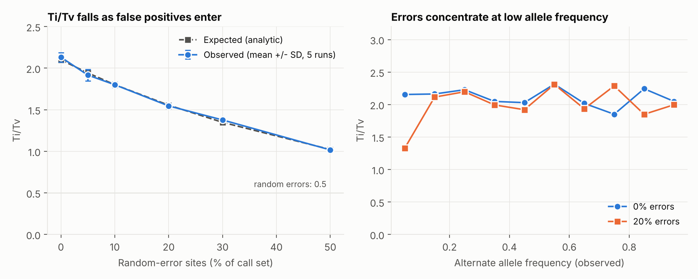
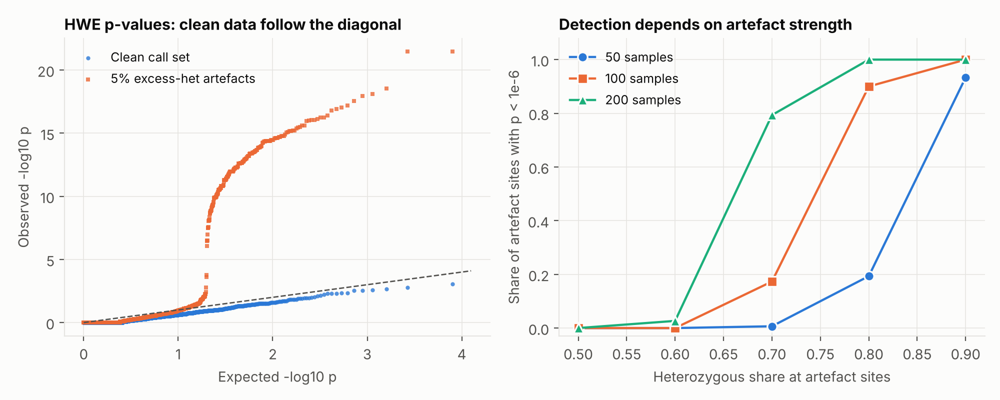
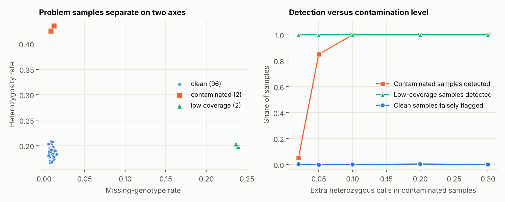

# vcf-qc-toolkit

[](https://github.com/iraajgangavaram/vcf-qc-toolkit/actions/workflows/tests.yml)

**Quality control for variant call sets (VCF), built from scratch and validated
against simulated data with known, planted problems.**

A VCF can look perfectly valid and still be full of false positives, mapping
artefacts and bad samples. This toolkit computes the checks that
population-genomics pipelines run before any downstream analysis: Ti/Tv,
Hardy-Weinberg equilibrium (with an exact test), allele-frequency spectra,
substitution spectrum, missingness, and per-sample outlier detection. Rather
than only reporting numbers, the project asks **whether the metrics actually
detect the problems they are meant to detect**, and measures how well.

It is written in pure standard-library Python (no numpy, pandas or external
VCF parser) and reads plain or gzipped VCF in a single streaming pass.

> **Headline results (all from simulation with known truth)**
> - Observed Ti/Tv tracks the analytic expectation as random errors are added
>   to a call set, to within **0.032** (mean over 5 runs per level), and errors
>   show up as a drop in Ti/Tv specifically at low allele frequency.
> - The exact Hardy-Weinberg test is **correct**: it matches exact rational
>   arithmetic on all **3,275** possible genotype tables with up to 25 samples,
>   and has **zero** false positives at p < 1e-6 on genuine sites.
> - Whether HWE *detects* artefacts depends strongly on artefact strength and
>   cohort size: with 100 samples it catches 90% of artefact sites where 80% of
>   samples are heterozygous, but only 17% at 70%, and none at 60%.
> - Robust outlier flags found **100%** of planted low-coverage samples and
>   **100%** of contaminated samples at 10% or more extra heterozygous calls
>   (85% at 5%), with at most 0.4% of clean samples falsely flagged.

## Contents

1. [What it computes](#what-it-computes)
2. [Quick start](#quick-start)
3. [How the metrics are defined](#how-the-metrics-are-defined)
4. [Validation experiments](#validation-experiments)
5. [Testing](#testing)
6. [Limitations](#limitations)
7. [Repository layout](#repository-layout)
8. [References](#references)

## What it computes

| Level | Metric |
|---|---|
| Call set | variant types (SNP, MNP, insertion, deletion, symbolic), Ti/Tv, FILTER and QUAL summaries, per-chromosome counts, indel length distribution, six-class substitution spectrum |
| Allele frequency | AF histogram from the INFO field and from genotypes, Ti/Tv by allele-frequency bin, singleton and doubleton counts |
| Per site | missingness, allele count, observed allele frequency, **exact Hardy-Weinberg p-value** (optional TSV, one row per site) |
| Per sample | genotype counts, missingness, heterozygosity rate, mean depth (DP), mean genotype quality (GQ), singletons, Ti/Tv, and robust outlier flags |

## Quick start

```bash
pip install -e ".[test]"        # add ",figures" to also regenerate the plots

python -m vcfqc examples/simulated_cohort.vcf.gz               # text report
python -m vcfqc calls.vcf.gz --json > qc.json                  # machine-readable
python -m vcfqc calls.vcf.gz --site-table sites.tsv            # per-site table for filtering
python -m vcfqc calls.vcf.gz --hwe-threshold 1e-8              # stricter HWE cut-off
```

The repository ships a simulated 40-sample cohort with planted problems
(`examples/simulated_cohort.vcf.gz`, truth in `examples/simulated_cohort_truth.json`).
Abridged output:

```text
Records:            1500
Variant types:      SNP=1500
Ti/Tv (SNPs):       1.825  (969 ts / 531 tv)
Substitutions:      C>A=123, C>G=141, C>T=494, T>A=142, T>C=475, T>G=125

Site QC:            mean missingness 0.0156, 1 sites above 10%, singletons 348, doubletons 178
HWE (exact test):   1500 sites tested, 17 with p < 1e-06, min p 2.62e-10, 0 skipped
Ti/Tv by AF bin:    1.66 2.07 2.71 2.22 2.09 1.70 3.44 2.00 1.40 1.20

Flagged samples (robust outliers):
  S025: het_rate z=+18.6
  S023: missing_rate z=+85.0; mean_dp z=-4.3
```

The two flagged samples are exactly the two that were planted: `S025`
(contaminated, extra heterozygous calls) and `S023` (low coverage). The 17 HWE
failures are planted excess-heterozygosity sites; 30 were planted, and with
only 40 samples the test catches 17 of them (57%). That is lower than the
50-sample sensitivity in the curve below, as expected for a smaller cohort.

Python API:

```python
from vcfqc import parse_vcf, summarize

sites = []
with open("calls.vcf") as fh:
    samples, variants = parse_vcf(fh)
    summary = summarize(samples, variants, hwe_threshold=1e-6, site_sink=sites)

print(summary["ti_tv"], summary["flagged_samples"])
```

## How the metrics are defined

**Counting unit.** Variant types, Ti/Tv and the substitution spectrum are
counted **per alternate allele**, so a multiallelic record contributes one
count per ALT. `n_records` counts VCF lines.

**Ti/Tv.** Transitions (A<->G, C<->T) over transversions, single-base
substitutions only. Random errors are transitions only one time in three, so a
call set contaminated with false positives has a Ti/Tv that falls toward 0.5.
Commonly cited reference values for human data are around 2.0-2.1 for whole
genomes and around 3 for exomes (e.g. Wang et al. 2015), but small or
targeted call sets can legitimately differ, so compare against a comparable
reference set instead of a fixed number.

**Substitution spectrum.** Six strand-collapsed classes (C>A, C>G, C>T, T>A,
T>C, T>G): a purine reference is reverse-complemented, so G>A counts as C>T.

**Hardy-Weinberg equilibrium (exact test).** For a biallelic site with
genotype counts (n_AA, n_AB, n_BB), the test conditions on the observed allele
counts and sums the probabilities of all heterozygote counts that are no more
likely than the observed one (Wigginton et al. 2005). The recursion runs in
O(n) per site and is stable for biobank-scale sample sizes. Sites that are
multiallelic, non-diploid or have no called genotypes are skipped and counted.
Both an excess and a deficit of heterozygotes give small p-values: excess
heterozygosity typically points to paralogous reads collapsing onto one locus,
a deficit to genotyping error or population structure.

**Observed allele frequency.** Alternate-allele frequency among called
genotypes at diploid biallelic sites. Ti/Tv by allele-frequency bin uses this,
and falls back to the INFO `AF` where there are no genotypes.

**Sample outliers.** For heterozygosity rate, missingness rate and mean depth,
each sample gets a robust z-score `(x - median) / (1.4826 * MAD)`. Samples
with |z| above 3.5 are flagged, with the metric and score reported. The median
and MAD keep a few bad samples from hiding themselves by inflating the spread.
With fewer than 5 samples, or when the MAD is zero, no flags are produced
because outliers cannot be assessed.

## Validation experiments

All experiments use `vcfqc.simulate`, which generates a multi-sample VCF with
**known** real variants, **planted** artefacts and **planted** problem samples
(see the module docstring for the generative model). Artefact sites carry an
`ARTEFACT` flag in INFO so that experiments can score the output; `vcfqc`
itself never reads it. Reproduce everything with `python scripts/validate_qc.py`
(about 2.5 minutes; every run is seeded).

### A. Ti/Tv versus false-positive load

Real variants have an expected Ti/Tv of 2.1; random-error sites have a random
ALT base, giving an expected Ti/Tv of 0.5. For an error fraction *f* the
analytic expectation is closed-form (`vcfqc.simulate.expected_ti_tv`).
6,000 sites and 40 samples, 5 runs per level:

| Random-error sites | Observed Ti/Tv (mean, SD) | Expected |
|---:|---:|---:|
| 0%  | 2.132 (0.056) | 2.100 |
| 5%  | 1.917 (0.069) | 1.943 |
| 10% | 1.800 (0.034) | 1.801 |
| 20% | 1.546 (0.033) | 1.555 |
| 30% | 1.377 (0.021) | 1.348 |
| 50% | 1.017 (0.024) | 1.022 |



Maximum deviation from the expectation is 0.032. In the right panel the 20%-error
call set differs from the clean one mainly in the lowest allele-frequency bin,
where Ti/Tv drops from about 2.15 to 1.3 (the other bins are noisy, with a few
hundred sites each). In this simulation the errors are planted at low allele
frequency, so this shows what the stratified metric can reveal, not how real
errors are distributed.

### B. Hardy-Weinberg: correctness and detection

*Correctness.* The recursion is checked against brute-force enumeration with
exact rational arithmetic for every genotype table with up to 25 samples
(3,275 tables), plus symmetry, boundary and large-n cases (`tests/test_hwe.py`).

*False positives.* On genuine (simulated-HWE) sites the false-positive rate at
p < 1e-6 was **0** in every configuration, and at p < 0.05 it was at most 2.9%,
below nominal because exact tests are conservative (clean data lie slightly
under the diagonal in the QQ plot).

*Detection.* Excess-heterozygosity sites make up 5% of 3,000 sites. Sensitivity
at p < 1e-6 as a function of how heterozygous the artefact is:

| Heterozygous share at artefact sites | 50 samples | 100 samples | 200 samples |
|---:|---:|---:|---:|
| 0.5 | 0.000 | 0.000 | 0.000 |
| 0.6 | 0.000 | 0.000 | 0.027 |
| 0.7 | 0.007 | 0.173 | 0.793 |
| 0.8 | 0.193 | 0.900 | 1.000 |
| 0.9 | 0.933 | 1.000 | 1.000 |



The HWE filter is **not a universal artefact detector**: mild artefacts and
small cohorts slip through, which is why it should be combined with the other
metrics (depth, missingness, QUAL) rather than used alone.

### C. Detecting bad samples

100 samples, 2 contaminated and 2 low-coverage, 10 runs per setting. "Extra
heterozygous calls" is the probability that a contaminated sample is forced
heterozygous at a site.

| Extra heterozygous calls | Contaminated detected | Low-coverage detected | Clean samples falsely flagged |
|---:|---:|---:|---:|
| 0.02 | 0.05 | 1.00 | 0.003 |
| 0.05 | 0.85 | 1.00 | 0.000 |
| 0.10 | 1.00 | 1.00 | 0.001 |
| 0.20 | 1.00 | 1.00 | 0.004 |
| 0.30 | 1.00 | 1.00 | 0.001 |



Heterozygosity-based flags need a few percent of contamination before they
fire; low-coverage samples are caught immediately through missingness and depth.

## Testing

`pytest` runs 48 tests; CI runs them on Python 3.9, 3.11 and 3.12. Besides the
exact-test enumeration above, highlights include:

- a five-sample VCF whose every expected statistic (Ti/Tv per allele-frequency bin,
  per-sample depth and singletons, HWE p-values such as 5/45 = 1/9, spectrum counts)
  was worked out by hand;
- end-to-end recovery of planted problem samples and excess-heterozygosity sites;
- malformed input, missing headers, gzip handling, and CLI error paths.

## Limitations

- **Validation is on simulated data.** Planted artefacts are idealised and the
  sensitivity figures depend on the simulation settings. The tool has not been
  benchmarked against real call sets, nor compared with output from `bcftools stats`
  or VCFtools.
- Only `GT`, `DP` and `GQ` are read from sample columns. Reference-aware checks
  (REF matching the genome, trinucleotide context, CpG status) are not done.
- Diploid genotypes are assumed for HWE and allele frequency; haploid and
  multiallelic sites are counted and skipped for those statistics.
- Pure Python is convenient but slow on very large VCFs: about 2.5 seconds for
  6,000 sites by 100 samples on the development machine. For biobank-scale
  data, use `bcftools` or a compiled tool.
- Population structure and relatedness are not modelled; HWE deviations caused
  by real structure are indistinguishable from artefacts here.

## Repository layout

```text
vcfqc/            package: core (parsing, metrics), hwe (exact test), simulate, cli
scripts/          validate_qc.py (experiments A-C), _style.py
tests/            pytest suite (48 tests)
examples/         example.vcf, simulated_cohort.vcf.gz and its ground truth
docs/figures/     generated validation figures
docs/results/     generated validation tables (CSV) and summary
.github/workflows/tests.yml
```

## References

- Anderson CA, Pettersson FH, Clarke GM, Cardon LR, Morris AP, Zondervan KT (2010). Data quality control in genetic case-control association studies. *Nature Protocols* 5:1564-1573.
- Danecek P et al. (2011). The variant call format and VCFtools. *Bioinformatics* 27:2156-2158.
- Danecek P et al. (2021). Twelve years of SAMtools and BCFtools. *GigaScience* 10:giab008.
- Wang J, Raskin L, Samuels DC, Shyr Y, Guo Y (2015). Genome measures used for quality control are dependent on gene function and ancestry. *Bioinformatics* 31:318-323.
- Wigginton JE, Cutler DJ, Abecasis GR (2005). A note on exact tests of Hardy-Weinberg equilibrium. *American Journal of Human Genetics* 76:887-893.

## Author

Iraaj Gangavaram
